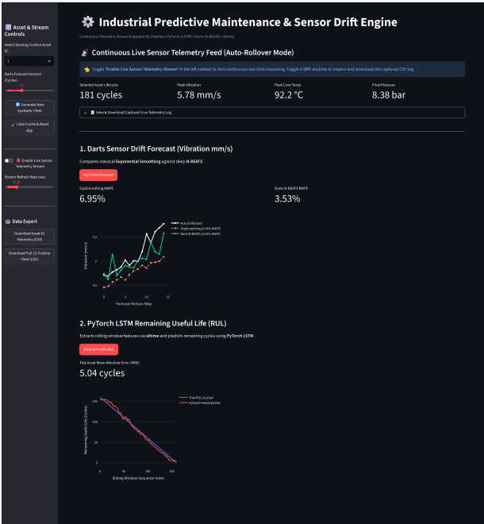
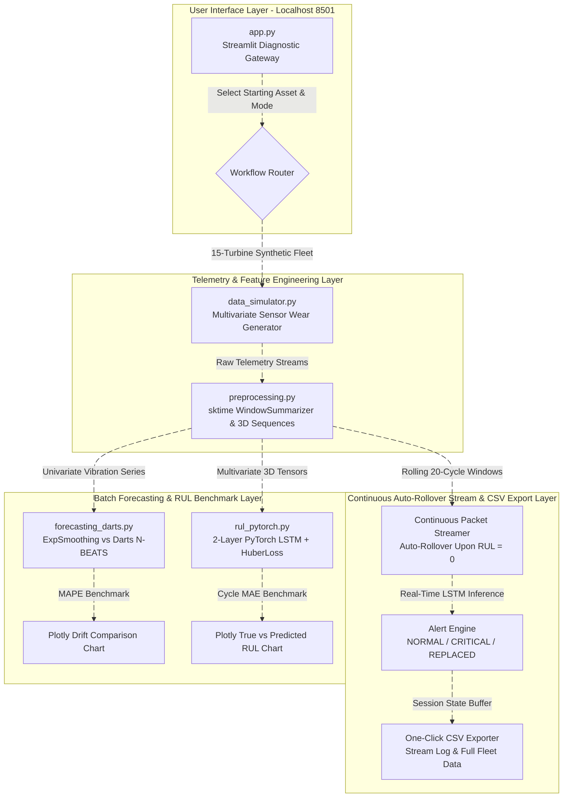

# ⚙️ Industrial Sensor RUL & Drift Engine


A local web application (`http://localhost:8501`) for **continuous real-time industrial sensor telemetry streaming**, **sensor drift forecasting**, **Remaining Useful Life (RUL) prediction**, and **automated CSV telemetry export** using **PyTorch**, **Darts**, **sktime**, and **Streamlit**.

## About

Industrial Sensor RUL & Drift Engine provides a modular, local-first applied machine learning pipeline for predictive maintenance—built from scratch with statistical time-series models and custom neural networks rather than third-party LLM wrappers.

Built and maintained by [@SRINIVASTA](https://github.com), this repository hosts a continuous auto-rollover telemetry stream simulator, an `sktime` sliding-window feature extractor, a `Darts` statistical vs. deep forecasting benchmark (`ExponentialSmoothing` vs. `N-BEATS`), a custom `PyTorch` 2-layer LSTM failure countdown engine, and one-click CSV data logging.

### ⭐ Show Your Support

If you like the UI design, system architecture, or industrial predictive maintenance engineering behind **Industrial Sensor RUL & Drift Engine**, please consider giving this repository a **Star ⭐** on GitHub! It helps showcase this work and motivates future builds.

---


## Modules in this repo

| Module | Description |
| :--- | :--- |
| `data_simulator.py` | Multivariate industrial turbine simulator generating correlated exponential mechanical wear curves across Temperature, Vibration, Pressure, and RPM until breakdown. |
| `preprocessing.py` | Time-series feature engineering pipeline using `sktime` (`WindowSummarizer`) for rolling lag/mean/std extraction and `MinMaxScaler` 3D sliding-window tensor generation. |
| `forecasting_darts.py` | Multi-step vibration drift forecasting benchmark comparing a classical statistical baseline (`ExponentialSmoothing`) against deep learning (`NBEATSModel`) via MAPE. |
| `rul_pytorch.py` | Custom 2-layer `PyTorch` LSTM architecture (`RULPredictorLSTM`) trained with `HuberLoss` to predict exact Remaining Useful Life (cycles) on unseen assets. |
| `app.py` | Interactive `Streamlit` and `Plotly` diagnostic dashboard (`http://localhost:8501`) featuring continuous multi-turbine auto-rollover streaming, real-time alert thresholding, CSV exports, and cached model benchmarks. |

### Architecture & Workflow



### Key Capabilities

* **Continuous Auto-Rollover Telemetry Stream:** Replays multivariate turbine degradation cycles in real time with live delta KPIs, dynamic line charts, and automated `NORMAL` → `CRITICAL` → `FAILURE / REPLACED` state transitions—automatically rolling over across all 15 fleet assets without stopping.
* **One-Click CSV Telemetry & Prediction Export:** Captures every streamed sensor packet alongside its real-time `PyTorch` predicted RUL and alert status in session memory for instant CSV download, plus sidebar exports for individual assets or the full 15-turbine fleet.
* **Statistical vs. Deep Forecasting (`Darts`):** Benchmarks classical `ExponentialSmoothing` (`6.95% MAPE`) against deep `N-BEATS` (`3.53% MAPE`) on multi-step vibration drift forecasting.
* **Custom Failure Countdown (`PyTorch` + `sktime`):** Extracts rolling time-series statistics via `sktime` and trains a custom 2-layer `PyTorch` LSTM (`6.98 cycles MAE` on unseen test turbines).

## Repository Structure

```text
industrial-sensor-rul-engine/
├── data/
│   └── simulated_turbine_telemetry.csv   # Generated or NASA C-MAPSS sensor logs
├── src/
│   ├── __init__.py
│   ├── data_simulator.py                 # Multivariate exponential mechanical wear generator
│   ├── preprocessing.py                  # sktime WindowSummarizer & 3D sequence builder
│   ├── forecasting_darts.py              # Darts ExponentialSmoothing vs N-BEATS pipeline
│   └── rul_pytorch.py                    # Custom PyTorch LSTM architecture & training loop
├── app.py                                # Continuous streaming Streamlit & Plotly dashboard
├── requirements.txt                      # Python dependencies
└── README.md
```

## Installation & Local Setup

You can clone and run the Industrial Sensor RUL & Drift Engine locally across Windows, macOS, and Linux:

### 1. Clone the repository

```bash
git clone https://github.com/industrial-sensor-rul-engine.git
cd industrial-sensor-rul-engine
```

### 2. Set up Python environment

```bash
# Create virtual environment
python -m venv venv

# Activate on Windows
venv\Scripts\activate

# Activate on macOS / Linux
source venv/bin/activate

# Install dependencies
pip install -r requirements.txt
```

### 3. Generate telemetry dataset (Optional)

```bash
python src/data_simulator.py
```

### 4. Launch the application

```bash
streamlit run app.py
```

Open your browser and navigate to `http://localhost:8501`.

## License

This repository is licensed under the MIT License — Copyright (c) 2026 [SRINIVASTA](https://github.com).

## Disclaimer

This project uses synthetically simulated multivariate industrial turbine telemetry for predictive maintenance modeling, benchmarking, and educational demonstration. For production deployment on physical machinery, models should be calibrated and validated against site-specific SCADA/PLC sensor baselines.

## ⭐ Support & Contribution

If you clone, test, or build upon this repository, please consider giving it a **Star (⭐)** on GitHub—it helps others discover the project and supports continued development.

* **Found a bug or have an idea?** Open an [Issue](https://github.com/industrial-sensor-rul-engine/issues).
* **Want to improve the code?** Feel free to **Fork** this repository and submit a Pull Request.

---

* **Lead Architect & Developer:** [Srinivasta](https://github.com)

### 🌐 Let’s Connect

[](https://www.linkedin.com/in/srinivas-t-a-557637119/)
[](https://www.kaggle.com/srinivasta)
[](mailto:tasrinivass@gmail.com)
[](https://github.com/srinivasta)
[](https://srinivasta.github.io)
